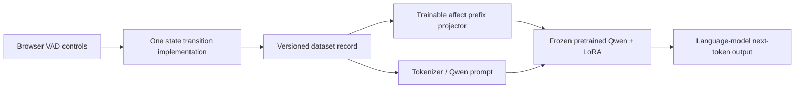

# Superior MI Affective Conditioning

**Superior MI Labs · Experimental research prototype (R0)**

[**Interactive research demo**](https://superior-mi-labs.github.io/Superior-MI-Affective-Conditioning/) · [Research design](docs/RESEARCH.md) · [Data contract](docs/DATA_CONTRACT.md)

A small, falsifiable experiment: can a language model learn to use a continuous affective state to vary its responses in useful ways? R0 includes two explicitly separate state-transition modes, **vector alignment** and **oscillatory phase**.

**Current evidence boundary:** The browser demo is **not an AI model**. It runs deterministic equations and deliberately simple response templates. The Python experiment contains a real trainable soft-prefix projector and LoRA path for compatible Hugging Face-format Qwen instruct models, but **no trained checkpoint or empirical empathy result is published here yet**.

## What exists

- Two clickable, keyboard-accessible valence/arousal planes, with dominance sliders.
- Manually supplied values for both AI internal state and observed message affect; no emotion prediction or diagnosis.
- Switchable vector-alignment and oscillatory-phase dynamics, with optional state persistence.
- Inspectable transitions, transcript/trace export, and **human-authored** target-response export for training.
- A minimal Python feature contract, trainable continuous soft-prefix mapper, LoRA training path, and one-shot local inference path.
- Automated numerical boundary, determinism, and input-validation tests.
- A single GitHub Pages workflow that runs browser/data tests and deploys the static site; no GPUs or model weights in CI.

## Try the public demonstration

Open [the GitHub Pages site](https://superior-mi-labs.github.io/Superior-MI-Affective-Conditioning/). Click the two plots, select a mode, enter a message, and run an interaction. The supplied reply is a **template** illustrating how state can affect response style. It is **not** an LLM answer. The page can run entirely as static files, has no API key, and sends no entered messages to a backend.

On a local checkout, serve the `web` directory rather than opening `index.html` as a file (JavaScript modules require HTTP in most browsers):

```bash
python3 -m http.server 8000 --directory web
# Browse http://localhost:8000
```

## Train a real local model (experimental)

This stage uses a **compatible Hugging Face Transformers-format, instruct-tuned checkpoint**, not a `.gguf` file. The `--model` argument can be your existing local HF model directory or a model ID such as `Qwen/Qwen2.5-0.5B-Instruct`. Qwen2.5-1.5B-Instruct is a follow-up scale-up; a 7B checkpoint is unnecessary for R0.

```bash
python3 -m venv .venv
source .venv/bin/activate
pip install torch transformers peft
export PYTHONPATH=src

# Smoke test of the code path only. Two synthetic examples are not research data.
python -m affective.train \
  --model /path/to/Qwen2.5-0.5B-Instruct \
  --data data/synthetic-smoke.jsonl \
  --output runs/smoke \
  --epochs 1 --allow-synthetic

# Real training: collect and review an appropriate dataset first.
python -m affective.train \
  --model /path/to/Qwen2.5-0.5B-Instruct \
  --data /path/to/approved-json-directory \
  --output runs/affective-r0 \
  --epochs 3

# Local greedy generation with explicit post-transition mood inputs.
python -m affective.chat \
  --model /path/to/Qwen2.5-0.5B-Instruct \
  --adapter runs/affective-r0 \
  --prompt 'I finally finished my project!' \
  --ai-vad 0.7 0.6 0.2 \
  --message-vad 0.9 0.8 0.3 \
  --mode vector
```

**Constraints:** For models with unsupported attention projection names or unavailable chat templates, the script fails explicitly rather than inventing compatibility. GPU memory requirements depend on the chosen model and sequence length. The Python training/inference path requires `torch`, `transformers`, and `peft`, and has **not yet been end-to-end run with downloaded Qwen weights** in this release; numerical and data-contract tests have been run independently. Avoid treating training loss as proof of affective intelligence.

Training updates a small **soft-prefix projection network** and LoRA weights, preserving the pretrained backbone's full weights. The injected prefix participates in standard transformer attention; no new tokenizer or custom GPU kernels are needed. The `chat` command accepts the state after the browser/controller has applied the chosen transition; it intentionally does **not** create a second authority for state transitions.

## Data collection

Each browser interaction records the initial AI vector, observed message vector, selected mode, phase, and resulting state. To export a supervised example, type the **desired assistant answer yourself**, then click **Export approved example**. The automatic template is not used as ground truth.

Place approved JSON exports into one directory and pass that directory as `--data`. The training loader rejects unapproved entries unless the explicit development-only `--allow-synthetic` flag is used. A `.jsonl` file containing records is also supported. See [data contract](docs/DATA_CONTRACT.md).

## Architecture boundaries



- **Research controller:** browser owns manual affect values and the selected state dynamics; there is no emotion classifier.
- **Feature contract:** nine floats (3 updated VAD + 3 observed VAD + mode bit + 2 phase features). Mode changes the transition and the representation, not the transformer topology.
- **Training:** assistant-target next-token cross-entropy; projector and LoRA trainable; original model weights frozen.
- **Inference:** ordinary transformer forward passes, with a small prefix-embedding adapter. The Python CLI demonstrates this without a new inference runtime.
- **Hosting:** GitHub Pages cannot run PyTorch/Qwen inference itself. A future hosted GPU/CPU service or compatible endpoint will be needed for model-generated chat on the public page. Do not paste private API tokens into a public page.

The R0 transition is a hand-defined experimental hypothesis, not an established theory of psychological emotion or evidence that a model has subjective feelings. Its parameters, and any later learned dynamics, must be evaluated against baselines and held-out scenarios. See [research design](docs/RESEARCH.md).

## Local tests

```bash
node --test tests/affect.test.mjs
python3 -m unittest discover -s tests -p 'test_*.py' -v
```

The Pages deployment runs both of these tests in the same deployment workflow to minimize GitHub Actions executions. The workflow does not start model training.

## Research roadmap

1. **R0:** Public static demo, versioned examples, mode contract, trainable local adapter, defensive tests.
2. **R1:** Collect diverse, reviewed state-conditioned conversations; implement held-out evaluations and a matched textual-conditioning baseline.
3. **R2:** Train/evaluate against a real 0.5B chat model, compare vector/phase trajectories with a parameter-matched recurrent baseline; document negative results.
4. **R3:** Only after measured evidence: connect real inference to a hosted demo and test additional appraisal variables or learned dynamics.

## Research sources and licensing

- Russell & Mehrabian (1977), [Evidence for a three-factor theory of emotions](https://doi.org/10.1016/0092-6566(77)90037-X).
- Scherer (2009), [Appraisal theory discussion](https://people.ict.usc.edu/~gratch/CSCI534/Readings/Scherer-Chap-1.2.indd.pdf).
- [Qwen2.5-0.5B-Instruct model card](https://huggingface.co/Qwen/Qwen2.5-0.5B-Instruct) (base model licensing and requirements).

Our own original R0 prototype code is published under Apache-2.0 (see `LICENSE`). Upstream model and dataset licenses must be respected separately. **This repository contains no pretrained model weights.**
