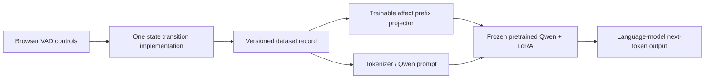

# Superior MI Affective Conditioning

**Superior MI Labs · Experimental research prototype (R0)**

[**Interactive research demo**](https://superior-mi-labs.github.io/Superior-MI-Affective-Conditioning/) · [Research design](docs/RESEARCH.md) · [Data contract](docs/DATA_CONTRACT.md)

A small, falsifiable experiment: can a language model learn to use a continuous affective state to vary its responses in useful ways? R0 includes two explicitly separate state-transition modes, **vector alignment** and **oscillatory phase**.

**Current evidence boundary:** The site offers deterministic simulation and real Qwen generation through either an opt-in local GGUF model service or browser ONNX inference on compatible hardware, **conditioned through ordinary text prompts**. Prompt conditioning is not the trainable affective soft-prefix/LoRA experiment. The Python research path contains that experimental training design, but **no trained affective checkpoint or empirical empathy result is published yet**.

## What exists

- Two clickable, keyboard-accessible valence/arousal planes, with dominance sliders.
- Manually supplied values for both AI internal state and observed message affect; no emotion prediction or diagnosis.
- Switchable vector-alignment and oscillatory-phase dynamics, with optional state persistence.
- Inspectable transitions, transcript/trace export, and **human-authored** target-response export for training.
- A minimal Python feature contract, trainable continuous soft-prefix mapper, LoRA training path, and one-shot local inference path.
- Automated numerical boundary, determinism, and input-validation tests.
- One unchanged chat/affect pipeline with two interchangeable transports: a locally running, authenticated llama.cpp GGUF service, or the existing Transformers.js/ONNX browser worker on supported machines.
- Browser WebGPU requires `shader-f16` for the supported Qwen3 graph. WASM/CPU is **explicit only**, because it failed session allocation (`std::bad_alloc`) on the test browser. The browser path probes three generated tokens before declaring readiness.
- A local launcher for an existing Qwen3-1.7B GGUF file; the service binds to loopback and allows one selected frontend origin per server launch.
- A single GitHub Pages workflow that runs browser/data tests and deploys the static site; no GPUs or model weights in CI.

## Use your existing GGUF model (recommended on Linux / Vivaldi)

Your public [GitHub Pages interface](https://superior-mi-labs.github.io/Superior-MI-Affective-Conditioning/) can connect **from your browser to a model on the same computer**. It is not a public GPU hosting service: each visitor would need their own compatible browser model or local service. The site never starts or scans for local services without an explicit click.

Install or build a recent [llama.cpp `llama-server`](https://github.com/ggml-org/llama.cpp/tree/master/tools/server) and make the executable available on your `PATH`. A CPU-only build works; a CUDA/Vulkan-enabled build can optionally offload layers to the GPU. Then, in your local clone of this repository:

```bash
bash scripts/run-local-qwen.sh
```

The script defaults to your cached `Qwen3-1.7B-Q4_K_M.gguf`. Optionally pass one of your other model paths as the first argument. To use a compatible GPU backend, set `SMI_GPU_LAYERS=99` (only if `llama-server` was built with GPU support). The script refuses to run if the model file or binary is missing. You can set `LLAMA_SERVER=/path/to/llama-server` if it is not on PATH.

The script prints the API key it generated once in `~/.config/smi-affective/llama-api-key`. It creates the key with restrictive file permissions and reuses it on subsequent launches. In the website, choose **Local GGUF server**, paste that key into the session-only field, then click **Connect local Qwen**. It queries `http://127.0.0.1:8080/v1/models` and uses the reported model ID for `/v1/chat/completions` with streamed responses. **The key is never stored in localStorage, sent to GitHub, or included in exported traces.**

`llama-server` binds to `127.0.0.1` rather than all network interfaces, allows **one** explicitly selected frontend CORS origin, and uses a required API key. The default is `https://superior-mi-labs.github.io`. Some llama.cpp builds incorrectly emit multiple configured origins as one `Access-Control-Allow-Origin` value, which browsers reject. Do not pass comma-separated origins or disable CORS to work around it. Do not remove those restrictions or enable llama.cpp agent/tool capabilities merely to make the demo work. Browsers can ask for permission to access loopback-network resources from a public HTTPS page; allow it only for this research site if you trust its source. If your browser still blocks the public page's loopback request, run the **same static UI locally**:

 ```bash
# Stop the GGUF server (Ctrl+C), then restart with the local UI origin:
SMI_CORS_ORIGIN=http://127.0.0.1:8000 bash scripts/run-local-qwen.sh
# In another terminal:
python3 -m http.server 8000 --bind 127.0.0.1 --directory web
# Open http://127.0.0.1:8000
```

The allowed origin must match the URL in the browser exactly. `http://localhost:8000` is also supported with `SMI_CORS_ORIGIN=http://localhost:8000`. Do not configure several origins at once. The API key is reused after a restart.

To check the public-site CORS preflight without sending your key:

```bash
curl -i -X OPTIONS http://127.0.0.1:8080/v1/models \
  -H 'Origin: https://superior-mi-labs.github.io' \
  -H 'Access-Control-Request-Method: GET' \
  -H 'Access-Control-Request-Headers: authorization'
```

The response should have exactly one `Access-Control-Allow-Origin: https://superior-mi-labs.github.io` header. If this passes but the browser still refuses access, inspect local-network permissions, private-network preflights, and browser mixed-content policy rather than changing the model.

This is the same UI and state logic, not a second runtime. Check the browser console for CORS, Local Network Access, or mixed-content errors. A failure to connect is not evidence that your local Qwen model cannot generate; verify the server independently before changing model files.

## Browser ONNX mode (secondary experiment)

Select **Browser WebGPU** only if the page reports `shader-f16` support. The browser downloads Qwen3-0.6B ONNX weights and runs the model inside the browser worker, using a three-token readiness probe. This mode does not connect to your GGUF files. **Browser CPU / WebAssembly** is retained only as an explicitly selected, high-memory experiment; it is not a dependable fallback. An ONNX `std::bad_alloc` during session creation means the runtime could not allocate memory, not that the affective state math failed. The supported browser graph may also fail on individual GPUs; the app should show the failure rather than pretending generation succeeded.

For **Vivaldi on Linux**, hardware acceleration and WebGPU are diagnosed in `vivaldi://gpu`. Advanced flags such as `vivaldi://flags/#enable-vulkan` or `vivaldi://flags/#enable-unsafe-webgpu` bypass browser safeguards and cannot add missing `shader-f16` capability. These flags are **not required** for the local GGUF service path.

**Evidence boundary:** Both real-model routes send manually selected VAD and phase/alignment information as ordinary prompt text. Neither loads or proves a trained affective LoRA or continuous soft-prefix. Their generated responses are real language-model inference, but the comparison currently tests **prompt conditioning**, not learned affective representations.

## Train a real local model (experimental)

This stage uses a **compatible Hugging Face Transformers-format, instruct-tuned checkpoint**, not a `.gguf` file. The `--model` argument can be your existing local HF model directory or a model ID such as `Qwen/Qwen2.5-0.5B-Instruct`. Qwen2.5-1.5B-Instruct is a follow-up scale-up; a 7B checkpoint is unnecessary for R0.

```bash
python3 -m venv .venv
source .venv/bin/activate
pip install torch transformers peft
export PYTHONPATH=src

# Smoke test of the code path only. Two synthetic examples are not research data.
python -m affective.train \
  --model /path/to/Qwen2.5-0.5B-Instruct \
  --data data/synthetic-smoke.jsonl \
  --output runs/smoke \
  --epochs 1 --allow-synthetic

# Real training: collect and review an appropriate dataset first.
python -m affective.train \
  --model /path/to/Qwen2.5-0.5B-Instruct \
  --data /path/to/approved-json-directory \
  --output runs/affective-r0 \
  --epochs 3

# Local greedy generation with explicit post-transition mood inputs.
python -m affective.chat \
  --model /path/to/Qwen2.5-0.5B-Instruct \
  --adapter runs/affective-r0 \
  --prompt 'I finally finished my project!' \
  --ai-vad 0.7 0.6 0.2 \
  --message-vad 0.9 0.8 0.3 \
  --mode vector
```

**Constraints:** For models with unsupported attention projection names or unavailable chat templates, the script fails explicitly rather than inventing compatibility. GPU memory requirements depend on the chosen model and sequence length. The Python training/inference path requires `torch`, `transformers`, and `peft`, and has **not yet been end-to-end run with downloaded Qwen weights** in this release; numerical and data-contract tests have been run independently. Avoid treating training loss as proof of affective intelligence.

Training updates a small **soft-prefix projection network** and LoRA weights, preserving the pretrained backbone's full weights. The injected prefix participates in standard transformer attention; no new tokenizer or custom GPU kernels are needed. The `chat` command accepts the state after the browser/controller has applied the chosen transition; it intentionally does **not** create a second authority for state transitions.

## Data collection

Each browser interaction records the initial AI vector, observed message vector, selected mode, phase, and resulting state. To export a supervised example, type the **desired assistant answer yourself**, then click **Export approved example**. The automatic template is not used as ground truth.

Place approved JSON exports into one directory and pass that directory as `--data`. The training loader rejects unapproved entries unless the explicit development-only `--allow-synthetic` flag is used. A `.jsonl` file containing records is also supported. See [data contract](docs/DATA_CONTRACT.md).

## Architecture boundaries



- **Research controller:** browser owns manual affect values and the selected state dynamics; there is no emotion classifier.
- **Feature contract:** nine floats (3 updated VAD + 3 observed VAD + mode bit + 2 phase features). Mode changes the transition and the representation, not the transformer topology.
- **Training:** assistant-target next-token cross-entropy; projector and LoRA trainable; original model weights frozen.
- **Inference:** ordinary transformer forward passes, with a small prefix-embedding adapter. The Python CLI demonstrates this without a new inference runtime.
- **Hosting:** GitHub Pages hosts only the frontend. Its model routes are a browser-local ONNX worker or an **explicitly connected** authenticated server on the visitor's own loopback interface. A truly public chat demonstration would require an independently hosted inference endpoint. No trained LoRA or continuous soft-prefix is currently served. Local API keys are entered per session and are never persisted in the page.

The R0 transition is a hand-defined experimental hypothesis, not an established theory of psychological emotion or evidence that a model has subjective feelings. Its parameters, and any later learned dynamics, must be evaluated against baselines and held-out scenarios. See [research design](docs/RESEARCH.md).

## Local tests

```bash
node --test tests/affect.test.mjs
python3 -m unittest discover -s tests -p 'test_*.py' -v
```

The Pages deployment runs these browser and Python contract tests in the same deployment workflow to minimize GitHub Actions executions. The workflow does not start model training.

## Research roadmap

1. **R0:** Public static demo, versioned examples, mode contract, trainable local adapter, defensive tests.
2. **R1:** Collect diverse, reviewed state-conditioned conversations; implement held-out evaluations and a matched textual-conditioning baseline.
3. **R2:** Train/evaluate against a real 0.5B chat model, compare vector/phase trajectories with a parameter-matched recurrent baseline; document negative results.
4. **R3:** Evaluate the trained adapter with real Qwen generation, then export it for browser execution or serve it from a proper inference backend. A hosted service is optional for today's unmodified browser Qwen.

## Research sources and licensing

- Russell & Mehrabian (1977), [Evidence for a three-factor theory of emotions](https://doi.org/10.1016/0092-6566(77)90037-X).
- Scherer (2009), [Appraisal theory discussion](https://people.ict.usc.edu/~gratch/CSCI534/Readings/Scherer-Chap-1.2.indd.pdf).
- [Qwen2.5-0.5B-Instruct model card](https://huggingface.co/Qwen/Qwen2.5-0.5B-Instruct) (base model licensing and requirements).

Our own original R0 prototype code is published under Apache-2.0 (see `LICENSE`). Upstream model and dataset licenses must be respected separately. **This repository contains no pretrained model weights.**
